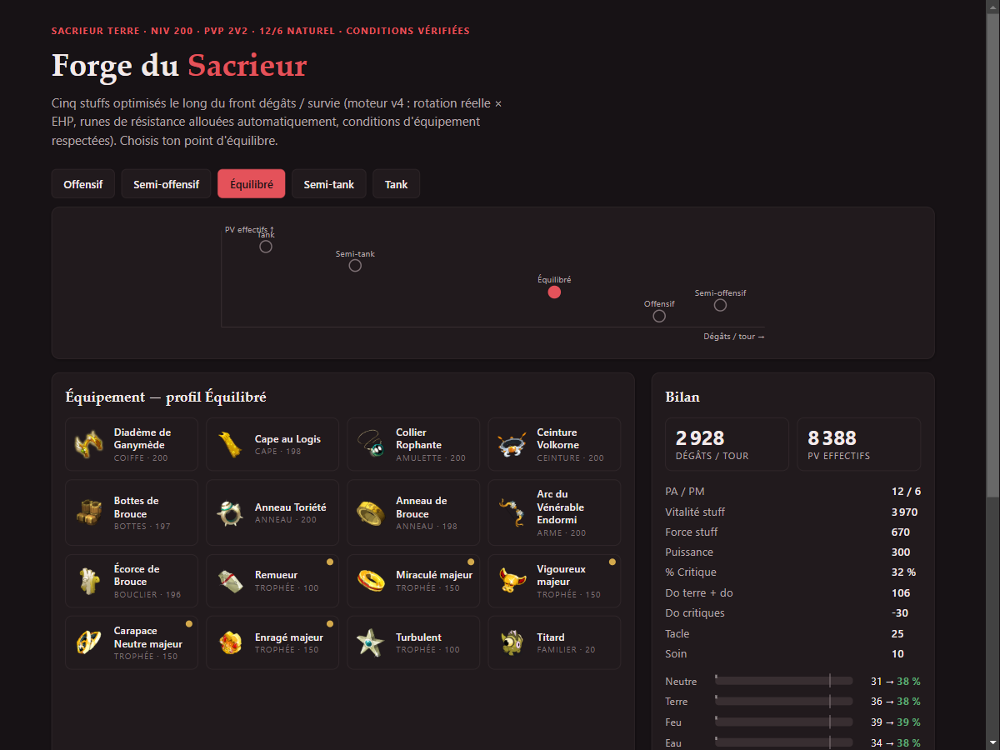

# Dofus Stuff Optimizer

[](https://github.com/morgannito/dofus-stuff-optimizer/actions/workflows/tests.yml)
[](LICENSE)
[](https://morgannito.github.io/dofus-stuff-optimizer/)

Optimiseur de stuff pour **Dofus 3 (Unity)** — trouve les meilleurs équipements niveau 200
sous les contraintes réelles du jeu, avec un objectif physique : **DPT de la meilleure
rotation × PV effectifs**, au lieu de pondérations arbitraires.

**Démos** : [5 builds pré-calculés](https://morgannito.github.io/dofus-stuff-optimizer/) ·
[Forge interactive dans le navigateur](https://morgannito.github.io/dofus-stuff-optimizer/opti.html)



## Méthode

- **Données** : [API DofusDude](https://docs.dofusdu.de) (~4300 équipements, panoplies,
  **conditions d'équipement**) + sorts des 20 classes (`data/spells.json`, extraits de
  l'API DofusBook — bases normales/critiques, coûts PA, % CC, lancers par tour).
- **Recherche** : recuit simulé multi-départs (parallélisés par processus) + polissage
  steepest-ascent exhaustif → optimum local 1-swap certifié. Évaluation **incrémentale
  O(1)** par mouvement.
- **Objectif** : `score = ln(DPT) + w_def · ln(EHP)`
  - **DPT** : la rotation n'est pas figée — un sac-à-dos 0/1 sur les PA choisit la
    meilleure combinaison de sorts *selon les stats du stuff courant* (crits espérés,
    limites de lancers/tour). Un stuff crit et un stuff plats ne jouent pas les mêmes sorts.
  - **EHP** : PV / (1 − res effective), res après allocation optimale des runes
    (*water-filling*, cap 50 %).
- **Contraintes** : cibles PA/PM (12/6 naturel ou exo), unicité des items, et
  **conditions d'équipement** (`PA < 12`, `PM < 6`, `Bonus de panoplies < 3`, seuils de
  caracs). Sans elles, l'optimiseur adore les items sur-statés réservés aux builds hors 12/6.

## Usage

```bash
python fetch_data.py                                  # dumps DofusDude -> data/
python optimize.py --classe sacrieur --element terre  # optimisation CLI
python optimize.py --element feu --mode exo-pa --profil tank --rolls p80
python optimize.py --element terre --lock "arme=Masse Étacée" --dofus --jobs 8
```

Options CLI : `--mode 12/6|exo-pa|exo-pa-pm`, `--runes N` (budget % res en runes),
`--profil offensif|equilibre|tank` ou `--wdef X`, `--rolls max|avg|p80`,
`--lock SLOT=ITEM` (répétable), `--dofus` (autorise Dofus/Prysmaradites),
`--jobs N` (processus parallèles).

Régénérer les pages : `python sweep.py && python gen_page.py && python build_webdata.py`.

Python 3.10+, aucune dépendance (pytest pour les tests). `pip install -e .[dev]`.

## Structure

| Fichier | Rôle |
|---|---|
| `engine.py` | Moteur : données, vecteurs de stats, état incrémental, recuit + polish, water-filling, conditions, rolls, locks |
| `rotation.py` | Objectif DPT×EHP + `SpellBook` (rotation optimale par DP) |
| `optimize.py` | CLI multi-classe/élément, restarts parallèles |
| `sweep.py` | Front dégâts/survie (5 profils) pour la page statique |
| `gen_page.py` / `build_webdata.py` | Pages : builds pré-calculés / forge interactive |
| `fetch_data.py` | Téléchargement DofusDude |
| `tests/` | Parsing, water-filling, état incrémental, conditions, DP de rotation |

CI : tests à chaque push ; refresh hebdomadaire des données + re-sweep + redéploiement
Pages (`.github/workflows/`).

## Limites connues

- Exos modélisés en agrégat (budget de runes res, cibles PA/PM) — pas par item.
- Les sorts à paliers de charge sont comptés à leur ligne de base (pas de sur-comptage).
- Le recuit trouve d'excellents optima locaux, pas une preuve d'optimalité globale.
- Sorts non-Sacrieur : extraits mais moins vérifiés — valider la rotation avant de s'y fier.

Projet non affilié à Ankama. Données © Ankama via DofusDude / DofusBook.
